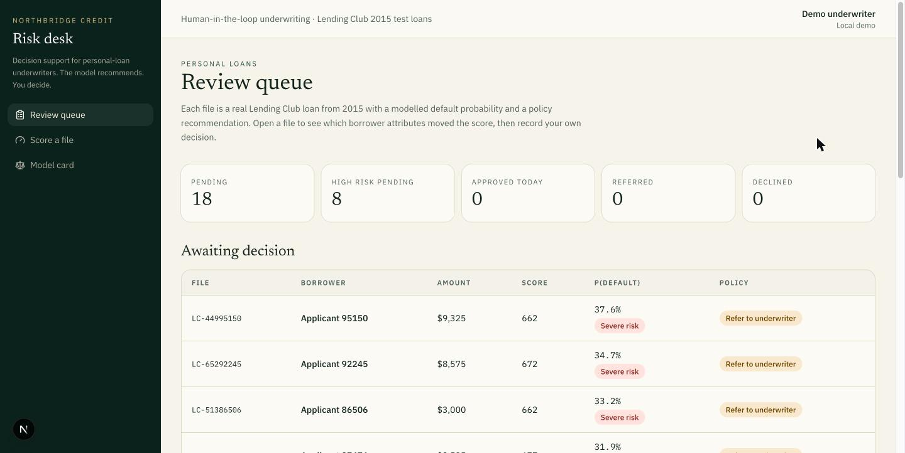
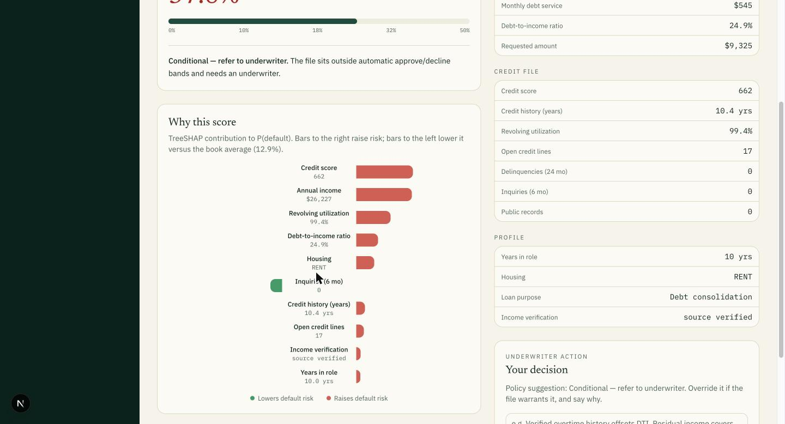
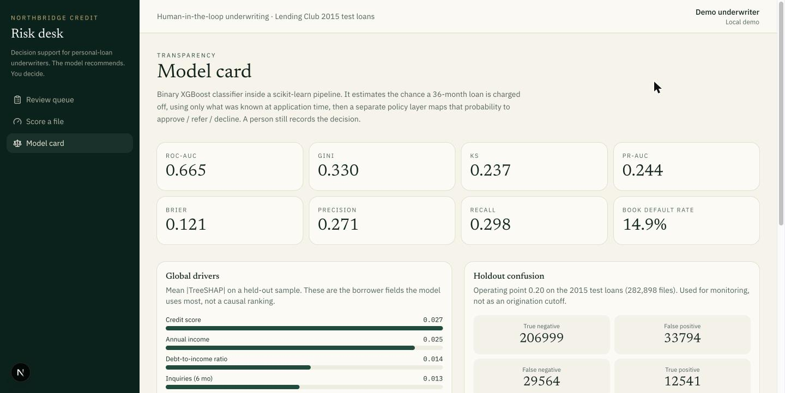

# Credit Risk Decision Support


A tool for loan underwriters, trained on about 590,000 real Lending Club loans. An XGBoost model estimates the chance that a borrower won't pay back a 36-month loan, SHAP explains which parts of the application pushed that number up or down, and a set of policy rules turns it into a suggestion: approve, refer, or decline. The underwriter still makes the call and writes down why.

I built it this way on purpose. In lending, a model that just says yes or no isn't very useful, because someone has to be able to explain and defend every decision. So the model here is one piece of evidence, not the decision.



## The data

I used Lending Club's public loan data (2007 to 2018, CC0) and kept the 36-month loans issued between 2012 and 2015. The data ends in December 2018, so every one of those loans had reached its final payment date and has a real outcome: paid off or charged off. Using later loans would have meant throwing away the ones still being repaid, which makes the default rate look worse than it is.

That leaves 589,186 loans with a 14% default rate. I split them by time, the way a lender would actually use a model:

- **Train:** 306,288 loans issued 2012 to 2014
- **Test:** 282,898 loans issued in 2015, which the model never saw

The model only uses what's on the application: income, loan amount, debt-to-income, FICO score, employment length, credit history length, revolving utilization, open accounts, delinquencies, inquiries, public records, housing, loan purpose and income verification. I left out Lending Club's own grade and interest rate on purpose. They're already a risk score, so including them would make the model look good without it learning anything.

## Results on the 2015 test loans

| Metric | Test |
| --- | ---: |
| ROC-AUC | 0.665 |
| Gini | 0.330 |
| KS | 0.237 |
| PR-AUC | 0.244 (base rate 0.149) |
| Brier score | 0.121 |

At a 0.20 cut-off, which is roughly where the policy rules start treating a file as elevated risk, it flags 16% of loans. About 27% of the flagged loans actually default (precision 0.271), almost twice the base rate, and it catches 30% of all defaults (recall 0.298).

An AUC around 0.66 is normal for this data when you don't use Lending Club's grade. Default is hard to predict from application fields alone, which is exactly why a person reviews the file.

The probabilities are well calibrated: across income quartiles the average predicted risk is within about two points of the real default rate (for example 18.1% predicted vs 19.1% actual for the lowest income quartile). I didn't reweight the classes during training, because the approve/refer/decline bands only make sense if the probabilities are close to real default rates. All numbers, including the confusion matrix and subgroup checks, are in [`artifacts/metrics.json`](artifacts/metrics.json).

## What's in it

- **Model:** a scikit-learn pipeline (one-hot encoding for categories) feeding an XGBoost classifier.
- **Explanations:** TreeSHAP in probability units. I sum the one-hot columns back into their original field, so "home ownership: rent" shows up as one reason instead of being split across several encoded columns.
- **Policy layer:** separate rules (risk score, FICO and DTI cut-offs) that map the probability to approve, refer or decline. Keeping them outside the model makes them easy to read and change.
- **Workbench:** a Next.js app where an underwriter opens a file, reads the drivers, and records a decision with notes. It talks to a FastAPI backend.

### Why a file got its score



Across the test set, the biggest drivers are FICO score, annual income, debt-to-income, recent inquiries and loan amount.

## Running it

You need Python 3.11+ and Node 20+. The trained model is committed in `artifacts/`, so you don't need the dataset just to run the app.

```bash
python -m venv .venv
source .venv/bin/activate   # Windows: .venv\Scripts\activate
pip install -r requirements.txt

python -m uvicorn api.main:app --host 0.0.0.0 --port 45232
```

In a second terminal:

```bash
cd web
npm install
npm run dev
```

Then open http://localhost:45231. The web app forwards `/backend/*` to the API.

Tests: `pytest` (they use a small synthetic generator, so they run in seconds without the real data).

## Retraining

1. Download `accepted_2007_to_2018Q4.csv` (1.7 GB), for example from [Hugging Face](https://huggingface.co/datasets/codesignal/lending-club-loan-accepted).
2. Build the loan table and train:

```bash
export PYTHONPATH=.
python scripts/prepare_lending_club.py path/to/accepted_2007_to_2018Q4.csv
python scripts/train.py
```

Training takes under a minute on a laptop CPU and rewrites everything in `artifacts/`.

## Project layout

```
credit_risk/   data loading, pipeline, SHAP, policy rules
api/           FastAPI: queue, scoring, explanations, decisions
web/           Next.js underwriter workbench
scripts/       data preparation, training, a sample explanation
artifacts/     trained model, metrics, model card, review queue
```

## Model card



- Task: whether a 36-month loan gets charged off
- Model: XGBoost (`hist`) inside a scikit-learn pipeline
- Explanations: `shap.TreeExplainer`, interventional, probability output
- Decision: always a human underwriter; the model never books a loan
- Fairness checks: Lending Club doesn't publish age, sex or race, so I can't test those directly. I check error rates by income quartile and housing type instead, and they're in the metrics file.

## Limitations

- These are loans Lending Club already approved. The model has never seen the applicants who were turned down, so it may not work well on them.
- Lending in 2015 isn't lending today. Default rates already rise from 12% in 2013 to 15% in 2015 in this data.
- Without protected attributes I can only check proxies like income and housing, which isn't a real fair-lending review.
- SHAP explains what the model did. It doesn't tell you whether a decision is fair or legal.
- The policy cut-offs are mine, not a real lender's.
- There's no identity verification, audit log storage, monitoring, or production security.

## License

MIT. Lending Club data is CC0.
